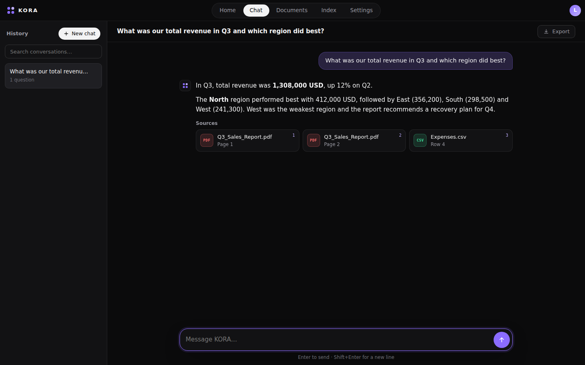
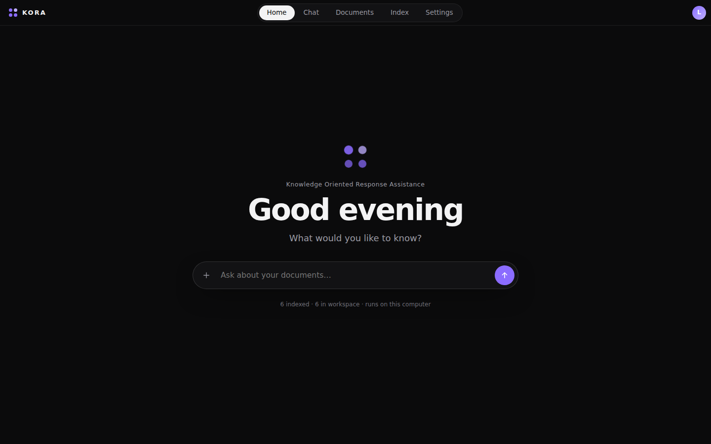
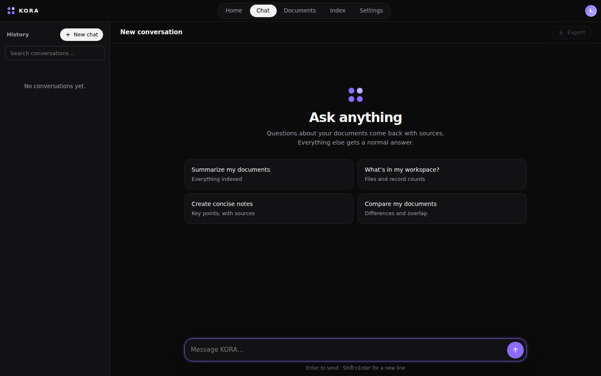
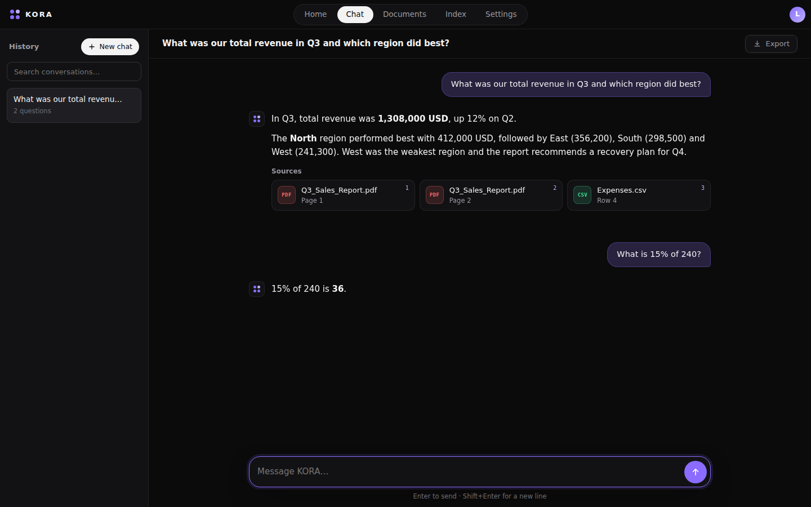
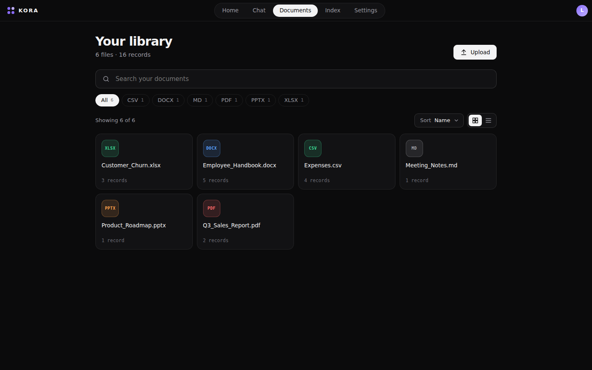
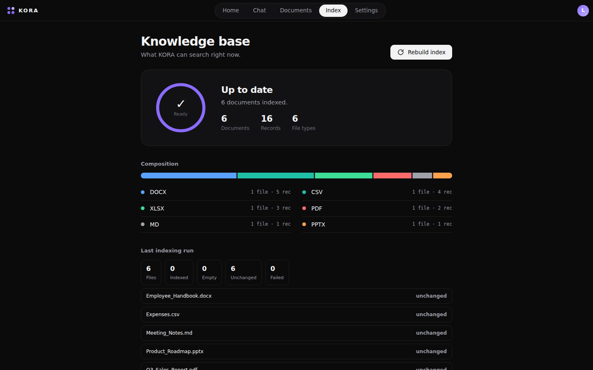
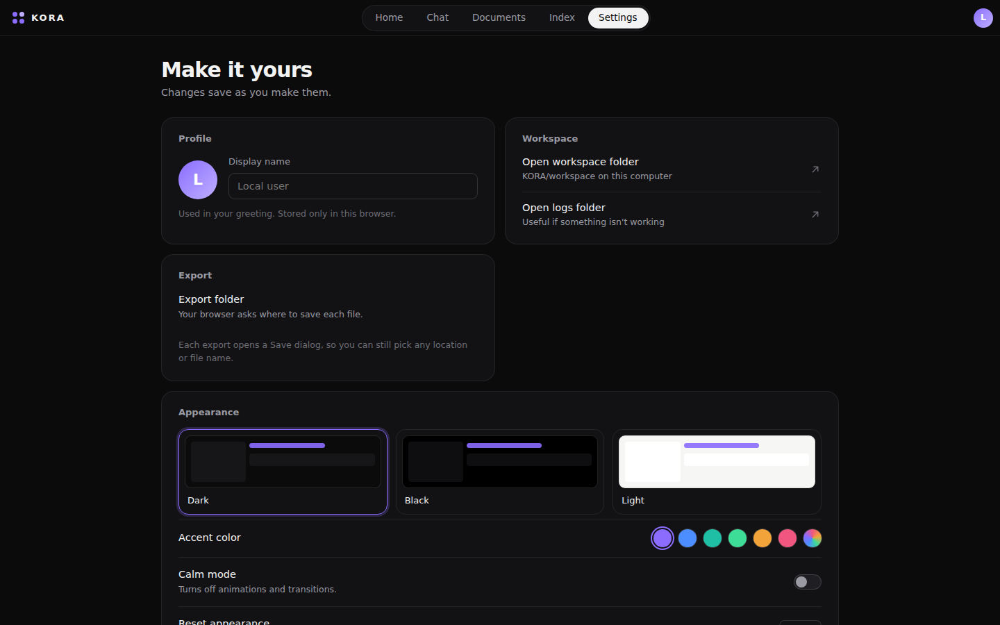

<div align="center">


# KORA

### Knowledge Oriented Response Assistant

A private, local-first web app that reads your documents and answers your questions about them, with sources, using AI models that run on your own computer.




</div>

---

> **Alpha:** KORA is still in active development. Expect rough edges, bugs, and changes between versions, and keep backups of any documents you add.

## About the project

KORA turns a folder of documents into a knowledge base you can talk to. Add PDFs, spreadsheets, Word files, slides, notes, or images, then ask a question in plain language. KORA finds the relevant passages, writes the answer, and shows exactly where it came from: the file and the page, sheet, row, or slide.

KORA is a **local web application**. A small Flask server runs on your computer (`http://127.0.0.1:5175`) and serves the interface in `src/web/`. It opens in its own app window (Microsoft Edge WebView2) or, if that is unavailable, in your default browser. The chat model and the embedding model run through local llama.cpp servers, so your files, index, and conversations never leave your machine and no internet is needed to use it.

Setup is automatic: it installs the Python packages, downloads both AI models and the llama.cpp Vulkan runtime, and installs Tesseract OCR and LibreOffice.

## Features

- **Answers with sources**: every answer built from your documents shows source cards with the file name and page, sheet, row, or slide.
- **Semantic search**: documents are split into records, embedded locally, and found by meaning, not only by keywords.
- **Exact calculations**: arithmetic is done by a Python calculator tool instead of being guessed by the model.
- **Streaming chat**: replies appear as they are written, with conversation history, conversation search, and starter prompts.
- **Document library**: upload files, search, filter by type, sort, switch between grid and list, preview, and remove documents.
- **Knowledge base view**: see what is indexed, the breakdown by file type, the result of the last indexing run, and the loaded models.
- **Export**: save any conversation as a formatted PDF with sources, or as editable Markdown.
- **OCR for scans and images**: Tesseract reads scanned PDFs and image files.
- **Automatic hardware tuning**: CPU, RAM, and GPU are detected at startup to choose context size, GPU offload, and threads. Pick Auto, Gentle, or CPU only in Settings.
- **Personalisation**: Dark, Black, and Light themes, accent colours, and a calm mode that turns off animations.

## Screenshots

<table>
  <tr>
    <td width="50%"><b>Home</b><br></td>
    <td width="50%"><b>Chat</b><br></td>
  </tr>
  <tr>
    <td width="50%"><b>Answers with sources</b><br></td>
    <td width="50%"><b>Exact calculations</b><br></td>
  </tr>
  <tr>
    <td width="50%"><b>Document library</b><br></td>
    <td width="50%"><b>Knowledge base</b><br></td>
  </tr>
  <tr>
    <td colspan="2"><b>Settings</b><br></td>
  </tr>
</table>

The screenshots use a small set of sample documents. They live in `docs/screenshots/`.

## How it works

1. **Ingest**: files in `data\workspace\` are read by `extractor.py`, using OCR for scanned pages and images, and split into records that remember their page, sheet, row, or slide.
2. **Index**: `knowledge.py` embeds every record with the local embedding model and saves the index under `data\`. Unchanged files are skipped on later runs.
3. **Ask**: your question goes to the local chat model, which can call Python tools to search the knowledge base, page through a document, list documents, read earlier messages, or calculate.
4. **Answer**: the model writes its reply from what the tools returned, and the interface shows the sources that were used.

See [docs/architecture.md](docs/architecture.md) for the module-by-module breakdown.

## Requirements

- Windows 10 or 11, 64-bit.
- 64-bit Python 3.11 or newer.
- Internet access for the first setup. It downloads the Python packages, the two AI models (about 0.6 GB), the llama.cpp runtime, and installs Tesseract OCR and LibreOffice.
- `winget`, used to install Tesseract OCR and LibreOffice. It is built into Windows 11 and Windows 10 version 1809 and later.
- A Vulkan-capable graphics card or integrated GPU is recommended. KORA falls back to the CPU if needed.
- Microsoft Edge WebView2 for the app window. Any modern browser works as a fallback.
- Free disk space for the Python environment, the models, the runtime, and your documents.

## Setup

1. Extract the project to a writable folder such as `C:\KORA-AI`. Do not run it from inside the ZIP or from `Program Files`.
2. Double-click **`setup_kora.bat`**. It creates `.venv`, installs `requirements.txt`, and then downloads or installs anything that is missing:
   - the chat model `Qwen3.5-0.8B-Q4_K_M.gguf` into `data\models\`
   - the embedding model `nomic-embed-text-v1.5.Q4_K_M.gguf` into `data\models\`
   - the official llama.cpp Windows **Vulkan** runtime into `data\runtime\vulkan\`
   - **Tesseract OCR** and **LibreOffice**, installed with `winget`, with their folders added to your `PATH` automatically

   Finally it compiles the source and runs a safe preflight check. Anything already present is skipped, so it is safe to run again.
3. Double-click **`run_kora.bat`**. If a model or the runtime is still missing, it downloads it before starting.

Windows shows one permission prompt each for Tesseract and LibreOffice. They are optional: if you decline, KORA still works, only without OCR.

**Setup options**

| Command | What it does |
|---|---|
| `setup_kora.bat` | Full setup, including downloads and installs |
| `setup_kora.bat --assets-only` | Only the model, runtime, Tesseract, and LibreOffice step |
| `setup_kora.bat --no-download` | Skip all downloads and installs |
| `setup_kora.bat --deps-only` | Only install the Python packages |

To use different models, set `KORA_CHAT_MODEL` or `KORA_EMBED_MODEL`, plus `KORA_CHAT_MODEL_URL` or `KORA_EMBED_MODEL_URL` if you want them downloaded as well. You can also put your own files in `data\models\` and your own runtime in `data\runtime\`.

## Using KORA

1. Add documents from the **Documents** page (Upload), from the plus button in the ask box, or by copying them into `data\workspace\`. KORA indexes them automatically.
2. Ask a question from **Home** or **Chat**. Questions about your documents come back with sources, and everything else gets a normal answer.
3. Open **Index** to check indexing status or to rebuild the index.
4. Use **Export** in a chat to save it as PDF or Markdown.

**Supported files:** PDF, TXT, Markdown, CSV, JSON, XLSX, XLS, DOCX, PPTX, PNG, JPG/JPEG, BMP, TIFF, and WEBP. OCR quality depends on Tesseract.

## Configuration

Defaults live in `src/config.py`. Override them with environment variables, with no code changes:

| Variable | Default | Purpose |
|---|---|---|
| `KORA_CHAT_MODEL` | `Qwen3.5-0.8B-Q4_K_M.gguf` | Chat model file in `data\models\` |
| `KORA_EMBED_MODEL` | `nomic-embed-text-v1.5.Q4_K_M.gguf` | Embedding model file in `data\models\` |
| `KORA_CHAT_MODEL_URL` | (none) | Where to download a custom chat model |
| `KORA_EMBED_MODEL_URL` | (none) | Where to download a custom embedding model |
| `KORA_PORT` | `5175` | Port of the KORA web app |
| `KORA_CHAT_URL` | `http://127.0.0.1:8080` | Local chat model service |
| `KORA_EMBED_URL` | `http://127.0.0.1:8081` | Local embedding service |
| `KORA_TOP_K` | `20` | Records returned per search page |
| `KORA_MAX_AGENT_STEPS` | `256` | Maximum tool steps per question |

## Diagnostics

Run `scripts\diagnose_kora.bat` to check the Python version, project files, dependencies, module imports, compilation, JavaScript syntax (if Node.js is installed), model files, runtime, Tesseract, and LibreOffice.

```bat
scripts\diagnose_kora.bat              rem safe preflight (default)
scripts\diagnose_kora.bat --models-only
scripts\diagnose_kora.bat --full       rem starts the services and tests the whole app
```

The full diagnostic writes a temporary file to `data\workspace\` and may load the models, so it can take a while.

## Troubleshooting

| Symptom | What to check |
|---|---|
| A model is missing | KORA downloads it automatically. If that failed, check your internet connection and run `setup_kora.bat` again, or put the exact file names in `data\models\`. |
| `llama-server` is missing | KORA downloads the Vulkan runtime automatically. If that failed, run `setup_kora.bat` again, or extract a llama.cpp Windows build into `data\runtime\vulkan\`, keeping the executable and its DLLs together. |
| KORA stays on the loading screen | Check `data\logs\chat.log` and `data\logs\embedding.log`. Make sure both models load and ports 8080 and 8081 are free. |
| OCR returns no text | Run `setup_kora.bat` again and accept the Tesseract permission prompt, then restart KORA. If you installed it yourself, make sure `tesseract.exe` is on `PATH`. |
| The app window does not open | Install or repair Microsoft Edge WebView2, or open `http://127.0.0.1:5175` in a browser. |
| A port is in use | Close the other KORA instance or app. Defaults: 8080 (chat), 8081 (embeddings), 5175 (KORA). |
| Anything else | Open **Settings > Open logs folder**, or look in `data\logs\kora.log`. |

## Project layout

```text
KORA-AI/
├── setup_kora.bat           # One-time setup: packages, models, runtime, OCR tools
├── run_kora.bat             # Starts KORA (fetches anything that is missing first)
├── requirements.txt         # Python packages
├── README.md
├── data/                    # Created automatically: models, runtime, workspace, logs
├── docs/
│   ├── architecture.md      # Module-by-module breakdown
│   └── screenshots/         # README screenshots
├── scripts/
│   ├── diagnose_kora.bat    # Preflight and full diagnostics
│   └── download_assets.ps1  # Fetches models, runtime, Tesseract, LibreOffice
├── build/                   # Optional PyInstaller packaging (build_exe.bat, kora.spec)
└── src/
    ├── main.py              # Startup, app window, and shutdown
    ├── server.py            # Flask API and web UI serving
    ├── engine.py            # Conversations and the tool-using agent loop
    ├── tools.py             # Search, document, calculator, and context tools
    ├── knowledge.py         # Index, retrieval, and ingestion
    ├── extractor.py         # File reading, OCR, and normalisation
    ├── llm.py               # Local chat and embedding client, system prompt
    ├── model_runtime.py     # Starts and monitors llama.cpp
    ├── tuning.py            # Hardware detection and performance profiles
    ├── exporter.py          # PDF and Markdown export
    ├── config.py            # Paths, model names, ports, settings
    ├── app_logging.py       # File logging and startup error dialogs
    ├── diagnose.py          # Preflight and full diagnostics
    └── web/                 # The web interface: HTML, JavaScript, CSS, logo
```

Model files, the llama.cpp runtime, your documents, the index, and logs all live in `data\`, which KORA creates on first run.
